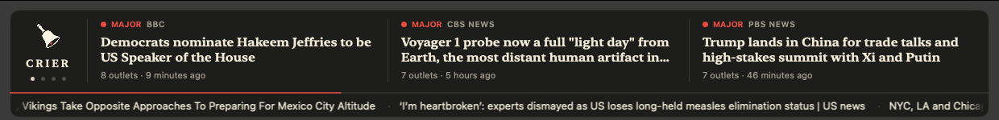
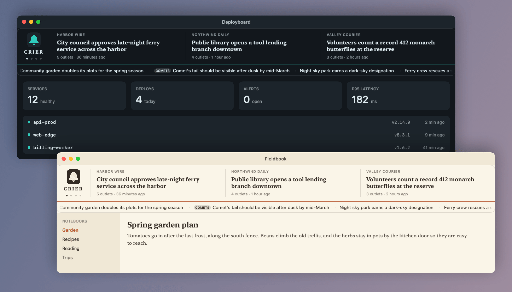

<p align="center">
  
</p>

# Crier

Crier is a quiet news ticker for the macOS menu bar. Headlines scroll in the bar's empty middle, or in a
thin strip just below it, and a notification arrives only when a story is truly major.

Crier is free. It is a work in progress.

## What it does

- Reads about thirty news feeds across politics, world affairs, economics, technology, science, movies,
  music, video games, pop culture, and sports, plus any RSS or Atom feeds you add.
- Groups the same story from different outlets and ranks stories by how many outlets carry them, weighed
  by how much of each topic you want. Each topic is set to More, Normal, Less, Major only, or Off. Out of
  the box it leans toward world affairs, politics, tech, and science, keeps movies, music, and games in
  the mix lower down, and holds pop culture and sports back until a story is major.
- Calls a story major when six or more outlets carry it, or twelve for a topic set to Less. Major
  stories get a red dot, and the newest ones can send a notification, with quiet hours, a daily cap,
  and no repeats.
- Keeps the teams and subjects you follow in the ticker.
- Fills the open menu bar with the ticker by default, or sets it at a fixed width at the center, left of
  center, or right of center. It stays clear of the status icons. A filling ticker runs on both sides of
  the notch and of the clock from Fuginaut, with headlines passing behind them. A fixed width ticker steps
  around them.
- Opens a window with a news band on top: the biggest stories as cards that take turns in rotating
  columns, each naming its outlet, how many outlets carry it, and how old it is, with the ticker running
  underneath. The full headline list sits below the band.

Hover over the ticker to hold it still, both sides at once when it is split. Click a headline to open it.

<p align="center">
  
</p>

<p align="center">
  
</p>

## Install

Crier needs macOS 14 or later. With Homebrew:

```sh
brew install --cask dcadolph/tap/crier
```

Or download `crier_macos_universal.dmg` from the
[latest release](https://github.com/dcadolph/crier/releases/latest), open it, and drag Crier to
Applications. Releases are signed with a Developer ID and notarized by Apple.

## Verify a download

Each release carries `SHA256SUMS` with a keyless cosign signature and a build provenance attestation.

```sh
cosign verify-blob SHA256SUMS --signature SHA256SUMS.sig --certificate SHA256SUMS.pem \
  --certificate-identity-regexp '^https://github.com/dcadolph/crier/\.github/workflows/release\.yml@refs/tags/v' \
  --certificate-oidc-issuer https://token.actions.githubusercontent.com
shasum -a 256 -c SHA256SUMS --ignore-missing
gh attestation verify crier_macos_universal.dmg --repo dcadolph/crier
```

## Build from source

```sh
make run
```

`make app` builds `Crier.app` in `.build`, and `make run` builds it and opens it.

## Settings

Open Settings from the bell in the menu bar. The ticker's place, position, width, speed, and color, how
much of each topic you want and which single feeds to read, the colors of the news window, followed
teams, your own feeds, and alert rules all apply right away. Hover over any control to see what it
changes. A feed that fails to load names the reason under its name.

With Accessibility permission, Crier reads where the frontmost app's menus end, so a ticker that fills
the bar never covers them. Without it, Crier keeps a fixed amount of room for the menus, which you can
change in Settings.

### Theme colors

A theme switcher can draw Crier in a theme's colors by posting the distributed notification
`com.dcadolph.crier.themeColor` with a string object of five words: the ticker's text color or `auto`
for the menu bar's own, a backing color for a pill behind the ticker or `none`, then the news window's
background, text, and accent. Each color is `#RRGGBB`. An empty string clears the theme, and Crier
ignores anything it cannot read. Your own settings stay as you set them, so clearing the theme puts
them back.

```sh
# Cyan headlines on a black pill, with a dark news window.
swift -e 'import Foundation; DistributedNotificationCenter.default().postNotificationName(.init("com.dcadolph.crier.themeColor"), object: "#5FE0F5 #000000 #030912 #E6F4F8 #30748C", userInfo: nil, deliverImmediately: true)'
```

## Emergency mode

Crier can watch for National Weather Service warnings where you are. It checks every two minutes for the
place you set, either a US ZIP code or, with no ZIP code, this Mac's location.

- A warning the Weather Service sends to phones, such as a tornado warning or a flash flood warning with a
  considerable threat, turns the ticker red, flashes it briefly, plays a sound you pick up to five times, and
  posts a notification. A click on the red line, or on the warning in the bell menu, acknowledges it and stops
  the sound. Until then the bell menu asks for that click. The red line stays until the warning ends or is
  canceled.
- Other watches and warnings, such as a flood watch or a winter storm warning, show as a quiet orange line
  with no sound.
- A setting widens what sounds to severe thunderstorm and flood warnings, or narrows it to tornado and
  civil emergencies only.

Limits worth knowing:

- It covers the United States only, since it reads the National Weather Service.
- It is not a primary warning system. It checks only while the Mac is awake and online, and some alerts
  your phone gets, such as evacuation orders sent straight from local officials, never reach the Weather
  Service feed.
- A ZIP code is checked at its center, so a narrow warning that covers your home but not that point can
  be missed.
- A muted Mac plays no sound.

Privacy: to ask for warnings, Crier sends your approximate location, rounded to about a city block, to
the National Weather Service. A typed ZIP code goes to Apple's geocoder to find that place. Nothing else
leaves the Mac for emergency mode, and emergency mode off sends nothing.

## CrierKit

The news engine and its SwiftUI views live in the `CrierKit` library, so another app can show the same
ticker and news band. Add this package as a dependency and use `News`, `TickerView`, `NewsBand`, and
`HeadlineList`. The cards, their rotation, the progress line, and the ticker all come from CrierKit. A
host app hands in its own colors, and the band takes them on.



The picture shows the real band inside two made-up apps, with invented outlets and headlines. To redraw it after
the band changes, run `swift run --package-path docs/showcase Showcase docs/crierkit.png`.

```swift
import CrierKit
import SwiftUI

struct Headlines: View {
    @State private var news = News()

    var body: some View {
        NewsBand(
            entries: news.entries,
            theme: BandTheme(background: .black, foreground: .white, accent: .orange, tile: .black, bell: BandTheme.gold),
            rotation: .seconds(30)
        )
        .onAppear { news.start() }
        .onDisappear { news.stop() }
    }
}
```

## Development

```sh
make build    # debug build
make test     # offline tests
make lint     # swift-format, strict
make format   # format in place
```

## License

MIT. See [LICENSE](LICENSE).
